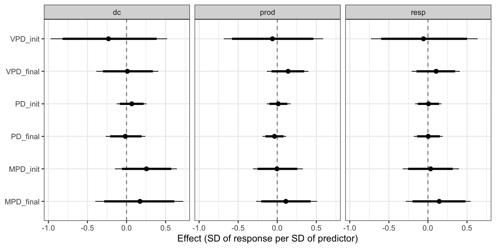
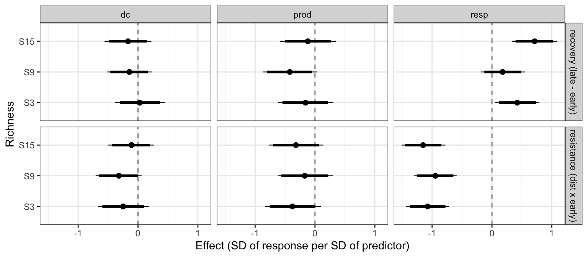
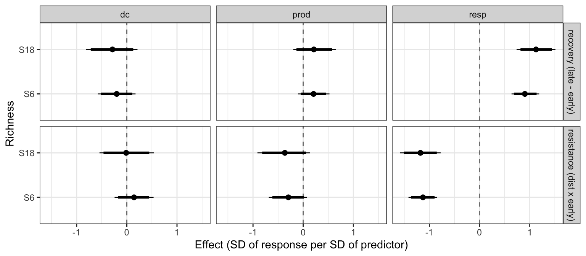









# Box 1. Phylogenetically structured species effects

[BOX 1 A ESCREVER: modelo de efeitos de espécies com covariância σ²_phy P C Pᵀ + σ²_id P Pᵀ, ligação com Diversity–Interactions models e com MPD, e resultado da contração prior→posterior da fração filogenética. Citado em Material and methods, Results e Discussion.]



# Acknowledgements

[OMITIDO NA VERSÃO ANÔNIMA]

# References

::: {#refs}
:::

# Tables

**Table 1.** [TABELA A MONTAR a partir de analysis/report.qmd, tbl-design: desenho dos experimentos T98 e T99 (pool de espécies, níveis de riqueza, células do desenho, número de composições e tanques, datas de amostragem e do pulso ácido).]

**Table 2.** [TABELA A MONTAR a partir de analysis/report.qmd, tbl-priors: priors de todos os parâmetros dos modelos, com a justificativa das simulações preditivas a priori.]

# Figure legends

**Figure 1.** Pseudochronograms of the species pools of the 1998 (T98, left; 21 species) and 1999 (T99, right; 24 species) pond mesocosm experiments, with time in millions of years. Tip colours indicate functional groups: macrophytes (green), periphyton grazers (blue) and invertebrate predators (orange). Notice that the deepest splits separate plants from animals and vertebrates (tadpoles) from protostomes, so that any metric computed over a whole composition is dominated by which functional groups it contains. [FIGURA PROVISÓRIA: árvores datadas em 2013; refazer se as árvores re-datadas com o TimeTree forem adotadas.]

**Figure 2.** Share of the variance of each phylogenetic metric among compositions that lies within design strata (T98, richness levels; T99, design cells defined by functional-group composition and richness), for stocked (purple) and realized (orange) compositions. PD, Faith's phylogenetic diversity; MPD, mean pairwise distance; VPD, variance of pairwise distances. Notice that, for stocked compositions, less than 4% of the variance of any metric remained within design cells in T99, and only VPD retained most of its variance within richness levels in T98. [FIGURA PROVISÓRIA]

**Figure 3.** Effects of phylogenetic metrics of stocked (init) and realized (final) compositions on decomposition (dc), productivity (prod) and respiration (resp) among compositions of the same richness in T98, in standard deviations of the response per standard deviation of the metric. Points are posterior means, thick bars 95% and thin bars 98.33% credible intervals. Notice that all intervals include zero. [FIGURA PROVISÓRIA: incluir o painel do T99, citado no texto junto com o T98.]

**Figure 4.** Among-composition variance in decomposition (dc), productivity (prod) and respiration (resp) explained by the design cells and by single phylogenetic metrics in T99, relative to a model with richness only. Bars are 95% credible intervals, truncated at zero because the ratio of variances is unbounded below. Notice that the design cells explained more of the variance in productivity and respiration than any single metric, and that PD explained almost none of it. [FIGURA PROVISÓRIA]

**Figure 5.** Effects of the acid pulse on decomposition (dc), productivity (prod) and respiration (resp) at each richness level in (a) T98 and (b) T99, split into a resistance phase (first sampling period or periods after the pulse; bottom row) and a recovery phase (difference between later and early periods; top row), in standard deviations of the response, estimated in the models with MPD of the stocked composition. Points are posterior means, thick bars 95% and thin bars 98.33% credible intervals. Notice that respiration dropped by about one standard deviation in both experiments and then recovered. [FIGURA PROVISÓRIA]

Figure B2: legend in Box 2.
