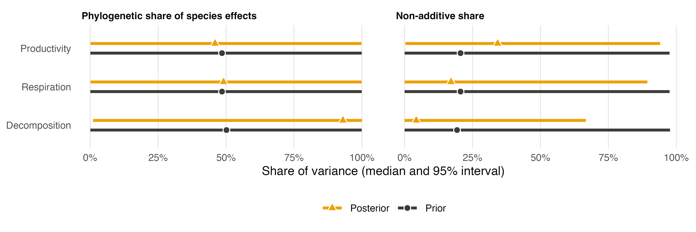
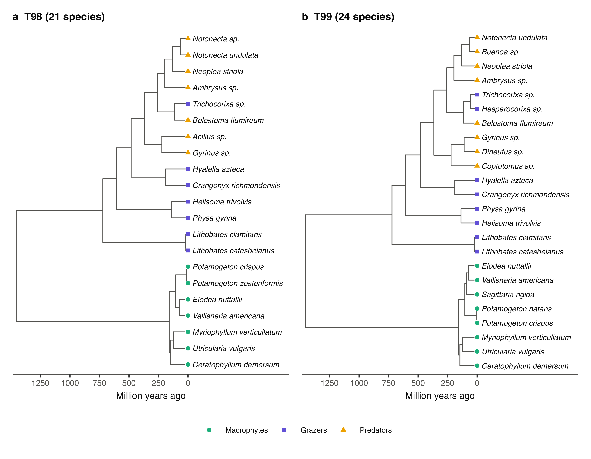
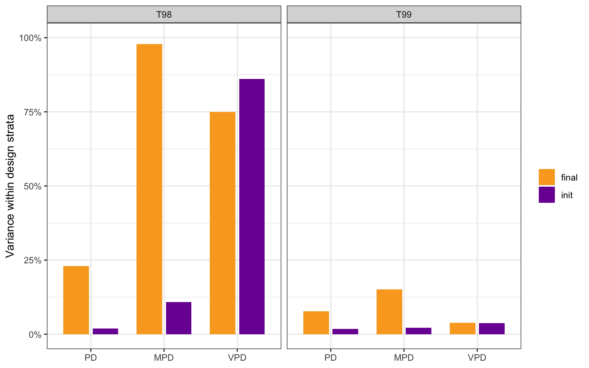
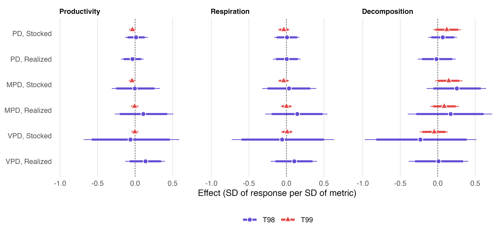
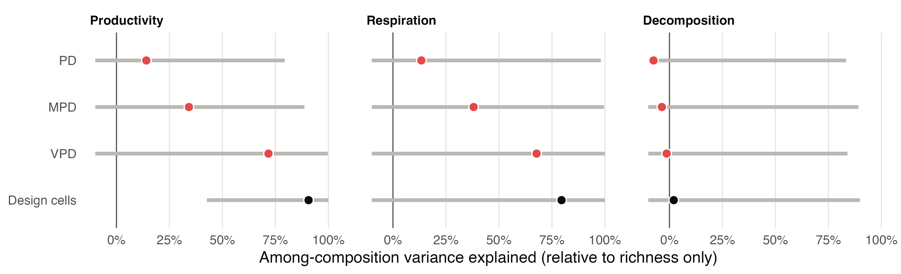
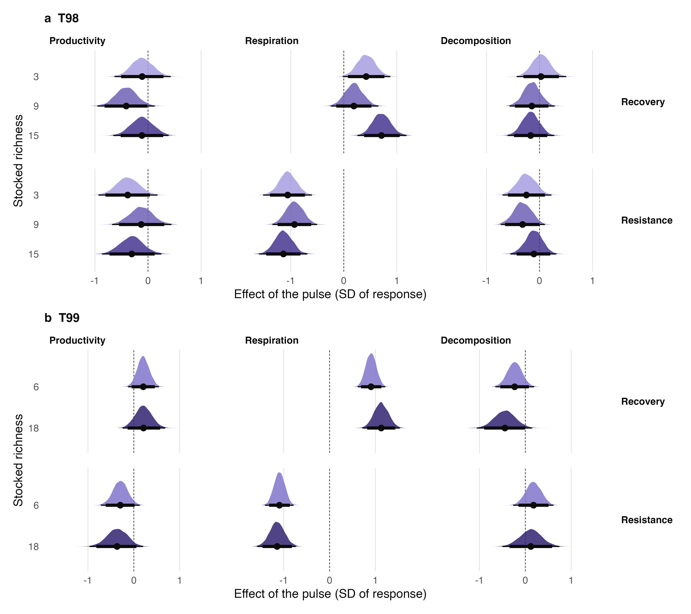
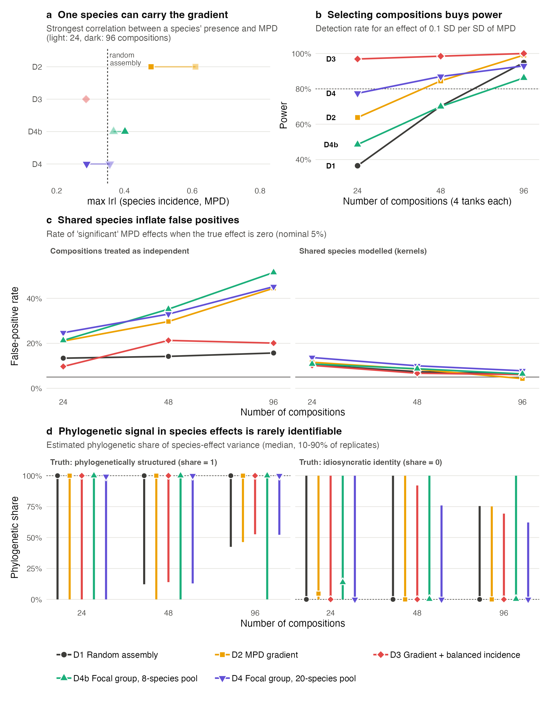













# Acknowledgements

[OMITIDO NA VERSÃO ANÔNIMA]

# References

::: {#refs}
:::

# Figure legends

**Figure 1.** Pseudochronograms of the species pools of the (a) 1998 (T98; 21 species) and (b) 1999 (T99; 24 species) pond mesocosm experiments, dated with node ages from TimeTree 5 (Kumar et al. 2022). Tip symbols indicate functional groups: macrophytes (green circles), periphyton grazers (purple squares) and invertebrate predators (yellow triangles). Notice that the deepest splits separate plants from animals and vertebrates (tadpoles) from protostomes, so that any metric computed over a whole composition is dominated by which functional groups it contains.

**Figure 2.** Share of the variance of each phylogenetic metric among compositions that lies within design strata (T98, richness levels; T99, design cells defined by functional-group composition and richness), for stocked (dark grey) and realized (yellow) compositions. PD, Faith's phylogenetic diversity; MPD, mean pairwise distance; VPD, variance of pairwise distances. Notice that, for stocked compositions, less than 4% of the variance of any metric remained within design cells in T99, and only VPD retained most of its variance within richness levels in T98.

**Figure 3.** Effects of phylogenetic metrics of stocked and realized compositions on productivity, respiration and decomposition among compositions of the same richness level in T98 (purple circles) and of the same design cell in T99 (red triangles), in standard deviations of the response per standard deviation of the metric. In T99, only MPD was computed for realized compositions. Points are posterior means, thick bars 95% and thin bars 98.33% credible intervals. Notice that all 98.33% intervals include zero.

**Figure 4.** Among-composition variance in productivity, respiration and decomposition explained by the design cells (black) and by single phylogenetic metrics (red) in T99, relative to a model with richness only. Points are posterior means and bars 95% credible intervals, truncated at −10% because the ratio of variances is unbounded below; negative values indicate that a metric did not reduce the among-composition variance. Notice that the design cells explained more of the variance in productivity and respiration than any single metric, and that PD explained almost none of it.

**Figure 5.** Effects of the acid pulse on productivity, respiration and decomposition at each stocked richness level in (a) T98 and (b) T99, split into a resistance phase (first sampling period or periods after the pulse; bottom row) and a recovery phase (difference between later and early periods; top row), in standard deviations of the response, estimated in the models with MPD of the stocked composition. Shaded densities are posterior distributions, coloured from lighter to darker with increasing stocked richness; points are posterior means, thick bars 95% and thin bars 98.33% credible intervals. Notice that respiration dropped by about one standard deviation in both experiments and then recovered.

Figure B2: legend in Box 2.
